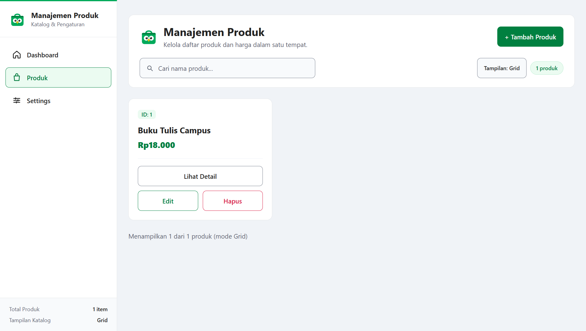
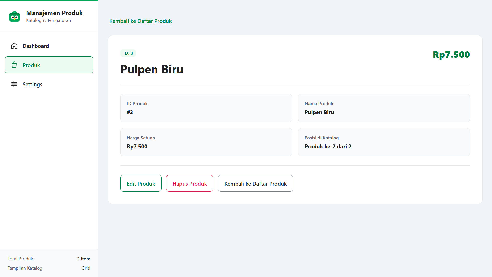
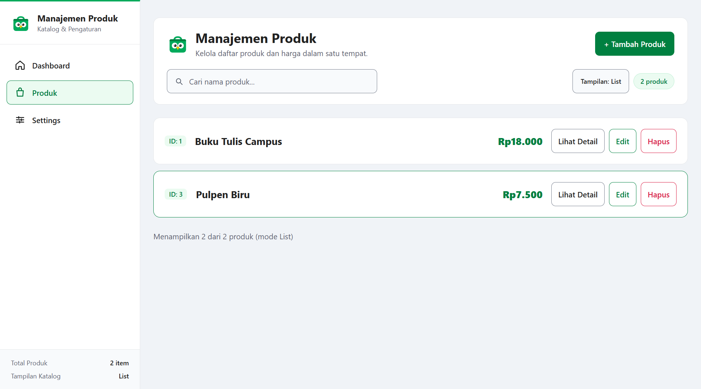
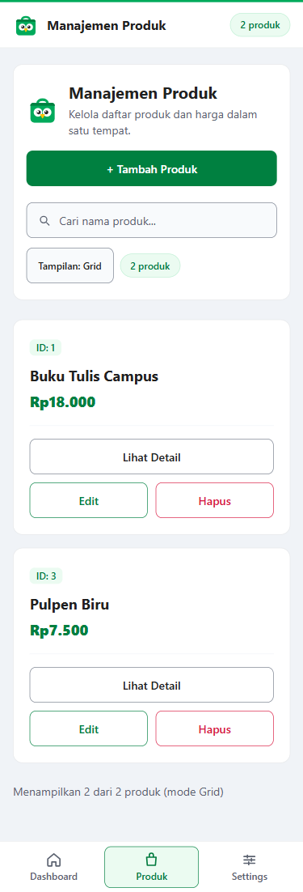

# Manajemen Produk (Tugas 4 Pemrograman Web)

Aplikasi frontend berbasis React 19, React Router v7, Vite, dan Tailwind CSS v4 untuk pengelolaan katalog produk multi-halaman yang terintegrasi dengan backend REST API ExpressJS dan database PostgreSQL (Prisma ORM) dari Tugas 2.


## Integrasi Backend ExpressJS dan Sentralisasi Tailwind CSS

- **Integrasi REST API ExpressJS + PostgreSQL**: seluruh operasi baca dan tulis produk terhubung ke server ExpressJS (`http://localhost:3000`) melalui Vite proxy `/api` pada [`vite.config.js`](vite.config.js) dan modul API client [`src/utils/productApi.js`](src/utils/productApi.js). Data produk tersimpan persisten di PostgreSQL dan bertahan saat halaman dimuat ulang.
- **Sentralisasi Tailwind CSS di Satu Berkas**: seluruh konfigurasi Tailwind CSS (`@import "tailwindcss";`, `@theme`, `@layer base`, dan `@layer components` via `@apply`) dipusatkan pada satu berkas, yaitu [`src/index.css`](src/index.css). Komponen JSX hanya memakai nama class semantik tanpa menyisipkan utility class Tailwind langsung di `className`.

## Endpoint API yang Digunakan

| Aksi UI | Request Frontend (Vite Proxy) | Diteruskan ke Backend ExpressJS |
|---|---|---|
| Muat daftar produk | `GET /api/products` | `GET /products` (`200 OK`) |
| Muat detail produk | `GET /api/products/:id` | `GET /products/:id` (`200 OK` / `404`) |
| Tambah produk baru | `POST /api/products` | `POST /products` (`201 Created`) |
| Perbarui produk | `PUT /api/products/:id` | `PUT /products/:id` (`200 OK`) |
| Hapus produk | `DELETE /api/products/:id` | `DELETE /products/:id` (`200 OK`) |

## Desain UI dan Aksesibilitas (WCAG AA dan 1.4.11)

Antarmuka memakai palet tema seller Tokopedia dengan pemeriksaan kontras teks, kontrol interaktif, dan state API (`loading`, `error`, dan `disabled`):

- Teks utama `#212121` di atas `#FFFFFF` (16,10:1) dan `#F0F3F7` (14,47:1); teks sekunder `#5B6270` di atas `#FFFFFF` (6,13:1) dan `#F0F3F7` (5,51:1).
- Aksi utama, tombol `Edit`, teks harga, dan ring fokus (`focus-visible`) memakai `#008040` (5,05:1 di atas `#FFFFFF`, 4,71:1 di atas `#EBFBF1`, 4,53:1 di atas `#F0F3F7`).
- Badge `ID` memakai `#007A3D` di atas `#EBFBF1` (5,09:1); aksi hapus, alert validasi, dan panel error API memakai `#D91B42` (5,02:1 di atas `#FFFFFF`) serta `#B81436` di atas `#FFF0F3` (5,96:1).
- Border input dan tombol netral memakai `#767E8C` (4,09:1 di atas `#FFFFFF`, 3,91:1 di atas `#F8FAFC`, 3,68:1 di atas `#F0F3F7`).
- Aksesibilitas keyboard didukung melalui skip link `"Lewati ke konten utama"` menuju `#main-content`, indikator `:focus-visible`, penutupan modal dengan `Escape`, target sentuh minimal 44px, serta navigasi responsif (sidebar desktop dan bottom navigation ponsel).

## Rute dan Struktur Modul

### Daftar Rute (`src/App.jsx`)

| Rute | Halaman / Perilaku |
|---|---|
| `/` | Redirect ke `/dashboard` |
| `/dashboard` | Ringkasan faktual katalog dari database (jumlah produk, total nilai satuan, rentang harga, mode tampilan aktif) dan daftar ringkas produk |
| `/products` | Halaman daftar produk dengan pencarian real-time, tambah/edit/hapus produk ke PostgreSQL, state loading/error + tombol `Coba Lagi`, serta mode `Grid` atau `List` |
| `/products/:id` | Mengambil detail produk dari `GET /api/products/:id`, menyediakan tombol Edit, Hapus, Link kembali, serta pesan jelas saat ID tidak ditemukan (`404`) |
| `/settings` | Pengaturan mode tampilan `Grid` atau `List` yang langsung diterapkan dan disimpan ke `localStorage` |
| `*` | Halaman `404` dengan pesan jelas, path URL yang diakses, dan tautan kembali |

### Modul Utama

| Modul | Lokasi | Peran |
|---|---|---|
| Stylesheet terpusat | `src/index.css` | Satu-satunya berkas Tailwind CSS dan seluruh class komponen (termasuk state loading, error, disabled) |
| Proxy & Env | `vite.config.js`, `.env.example` | Meneruskan `/api/*` ke `http://localhost:3000` saat dev dan preview |
| API Client | `src/utils/productApi.js` | Pembungkus `fetch` dan kelas `ApiError` untuk operasi CRUD ke ExpressJS |
| Entry & Router | `src/main.jsx` | Membungkus aplikasi dengan `BrowserRouter` |
| Root State & Routes | `src/App.jsx` | Mengelola fetch katalog, mutasi CRUD async, state loading/error modal, serta `<Routes>` |
| Layout Bersama | `src/components/Layout.jsx` | Skip link, sidebar desktop, mobile topbar & bottom navigation, dan `<Outlet />` |
| Halaman | `src/pages/DashboardPage.jsx`, `src/pages/ProductsPage.jsx`, `src/pages/ProductDetailPage.jsx`, `src/pages/SettingsPage.jsx`, `src/pages/NotFoundPage.jsx` | Implementasi masing-masing rute dan penanganan status loading/error/kosong |
| Komponen & Utilitas | `src/Navbar.jsx`, `src/ProductCard.jsx`, `src/ProductModal.jsx`, `src/DeleteModal.jsx`, `src/utils/formatPrice.js`, `src/utils/productUtils.js` | Toolbar produk, kartu grid/list, modal dengan state submit async, formatter, dan helper murni |

## Cara Menjalankan Backend, Frontend, dan Pengujian Lokal

1. Jalankan backend ExpressJS + PostgreSQL (dari proyek Tugas 2):

```bash
cd ../../tugas2/tugass2
node server.js
```

2. Pada terminal terpisah, jalankan frontend React + Vite:

```bash
npm install
npm run dev
```

Perintah verifikasi lokal (pada PowerShell Windows yang memblokir `npm.ps1`, gunakan `npm.cmd`):

```bash
npm test      # Menjalankan 11 unit test di tests/productUtils.test.js dan tests/productApi.test.js
npm run lint  # Menjalankan oxlint pada seluruh berkas sumber
npm run build # Membangun bundle produksi Vite ke folder dist/
```

## Pengujian E2E dan Bukti Tampilan

Pengecekan otomatis mencatat 11 dari 11 unit test lulus, `oxlint` bersih dengan 0 warning dan 0 error, serta `vite build` selesai tanpa error. Pengujian E2E langsung pada Chrome terhadap backend ExpressJS + PostgreSQL untuk viewport desktop (`1280x800`), tablet (`768x1024`), dan mobile (`375x812`) berjalan dengan 0 error runtime aplikasi dan 0 horizontal overflow (`scrollWidth <= innerWidth`), termasuk pengujian full page reload untuk membuktikan persistensi database.

| Skenario | Hasil yang Diharapkan | Hasil Aktual |
|---|---|---|
| Akses `/` menuju `/dashboard` dan `GET /api/products` | Redirect ke `/dashboard`, `GET /api/products` (`200 OK`) memuat data PostgreSQL (`ID: 1 Buku Tulis Campus Rp18.000`) | Sesuai |
| Tambah produk ke PostgreSQL dan reload halaman | `POST /api/products` (`201 Created`) untuk `Pulpen Gel` dan `Penggaris`; data tetap ada setelah full page reload | Sesuai |
| Pencarian, edit, dan hapus ke PostgreSQL | Filter `"Pulpen"` bekerja; `PUT /api/products/3` (`200 OK`) mengubah ke `Pulpen Biru`; `Escape` membatalkan hapus; `DELETE /api/products/4` (`200 OK`) menghapus `Penggaris` permanen | Sesuai |
| Halaman detail `/products/:id` setelah reload dan ID `99999` | Full reload `/products/3` memuat `GET /api/products/3` dan tampil sesuai ID; `/products/99999` menerima `404` dan menampilkan pesan tidak ditemukan | Sesuai |
| Pengaturan Grid/List dari `/settings` | Memilih `Tampilan List` mengubah status menjadi `Aktif` dan mengubah daftar `/products` menjadi list horizontal | Sesuai |
| Halaman 404 (`/*`) dan uji responsif Tablet/Mobile | URL `/halaman-tidak-ada` menampilkan halaman `404`; `scrollWidth <= innerWidth` pada `768x1024` dan `375x812`, footer berjarak 52px di atas bottom nav | Sesuai |

### Galeri Bukti Screenshot

| Halaman | Tampilan |
|---|---|
| Dashboard dari PostgreSQL (`1280x800`) |  |
| Produk Mode Grid dari PostgreSQL (`1280x800`) |  |
| Setelah Tambah & Full Reload (`3 produk`) |  |
| Setelah Edit & Hapus Permanen (`2 produk`) |  |
| Detail Produk `/products/3` Setelah Reload |  |
| Halaman Settings (`Tampilan List`) |  |
| Produk Mode List (`1280x800`) |  |
| Halaman 404 (`/halaman-tidak-ada`) |  |
| Tampilan Mobile (`375x812`) |  |
