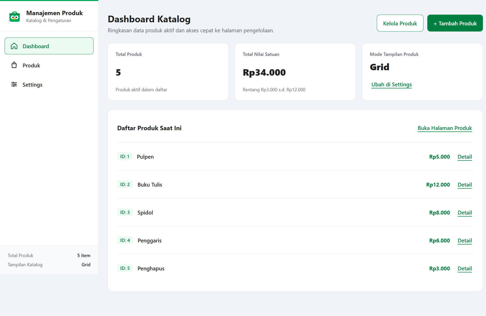
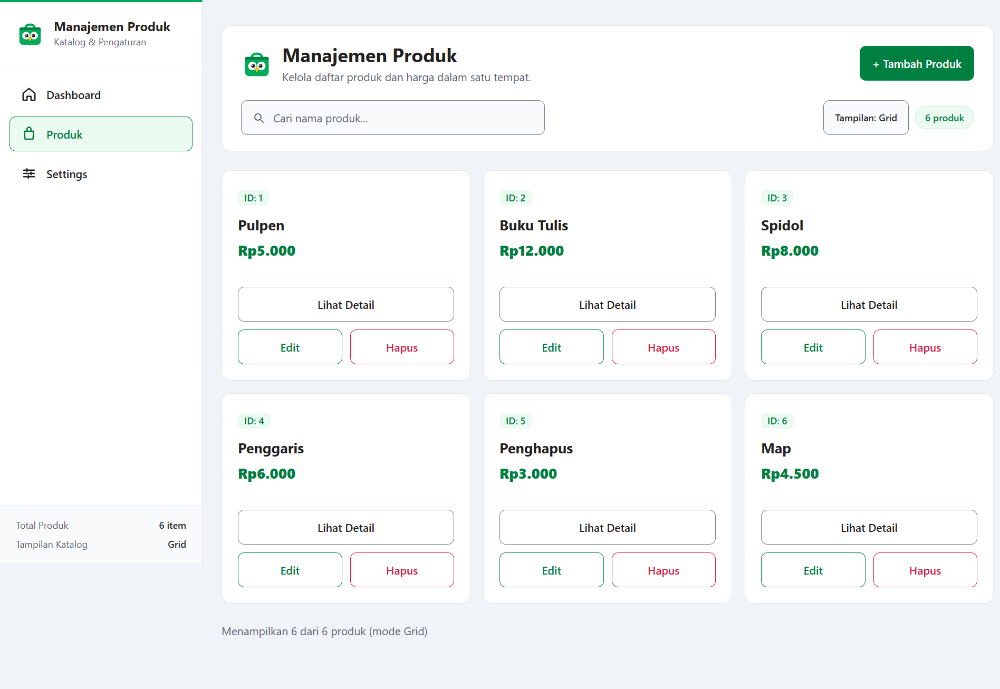
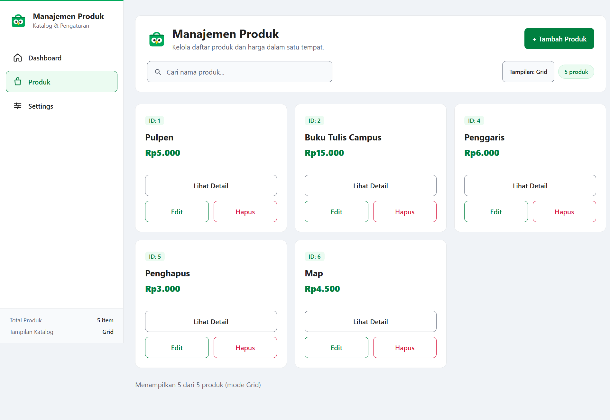
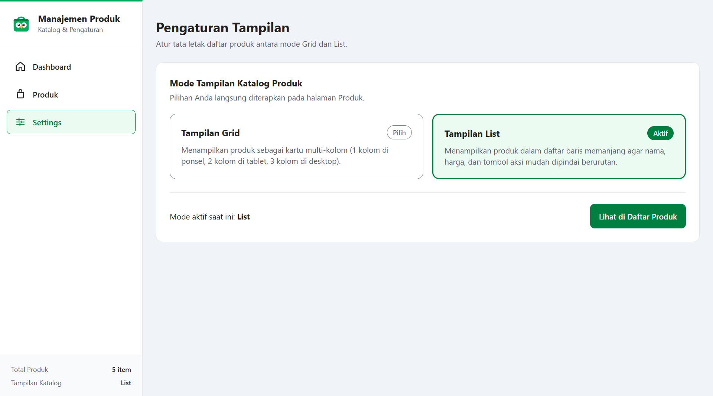
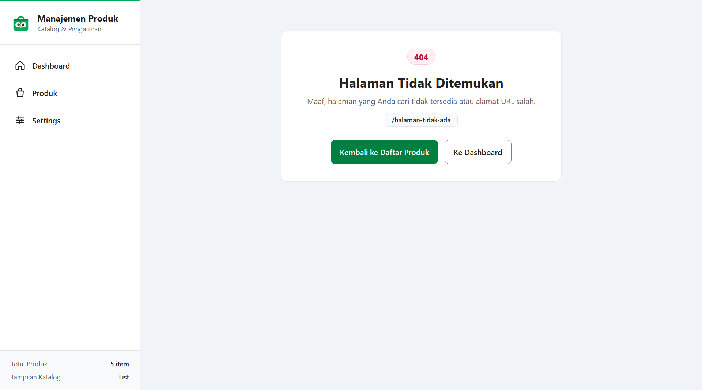

# Manajemen Produk (Tugas 4 Pemrograman Web)

Aplikasi frontend berbasis React 19, React Router v7, Vite, dan Tailwind CSS v4 untuk pengelolaan katalog produk multi-halaman. Proyek ini melanjutkan aplikasi CRUD dari Tugas 3 dengan menambahkan layout navigasi bersama, halaman Dashboard, daftar produk (mode Grid dan List), halaman detail produk dinamis (`/products/:id`), halaman pengaturan tampilan (`/settings`), serta halaman `404` untuk rute yang tidak ditemukan.



## Sentralisasi Tailwind CSS di Satu Berkas

Seluruh konfigurasi Tailwind CSS (`@import "tailwindcss";`, `@theme`, `@layer base`, dan `@layer components` dengan `@apply`) dipusatkan pada satu berkas, yaitu [`src/index.css`](src/index.css). Komponen JSX hanya memakai nama class semantik tanpa menyisipkan utility class Tailwind langsung di atribut `className`.

## Desain UI dan Aksesibilitas (WCAG AA dan 1.4.11)

Antarmuka memakai palet tema seller Tokopedia dengan pemeriksaan kontras teks dan kontrol interaktif:

- Teks utama `#212121` di atas permukaan `#FFFFFF` (16,10:1) dan latar `#F0F3F7` (14,47:1); teks sekunder `#5B6270` di atas `#FFFFFF` (6,13:1) dan `#F0F3F7` (5,51:1).
- Aksi utama, tombol `Edit`, teks harga, dan ring fokus (`focus-visible`) memakai `#008040` (5,05:1 di atas `#FFFFFF`, 4,71:1 di atas `#EBFBF1`, 4,53:1 di atas `#F0F3F7`).
- Badge `ID` memakai `#007A3D` di atas `#EBFBF1` (5,09:1); aksi hapus dan alert validasi memakai `#D91B42` (5,02:1 di atas `#FFFFFF`) serta `#B81436` di atas `#FFF0F3` (5,96:1).
- Border input dan tombol netral memakai `#767E8C` (4,09:1 di atas `#FFFFFF`, 3,91:1 di atas `#F8FAFC`, 3,68:1 di atas `#F0F3F7`) sehingga melewati ambang batas non-teks 3:1.
- Aksesibilitas keyboard didukung melalui skip link `"Lewati ke konten utama"` menuju `#main-content`, indikator `:focus-visible`, penutupan modal dengan `Escape`, target sentuh minimal 44px, serta navigasi responsif (sidebar di desktop dan bottom navigation di layar ponsel).

## Rute dan Struktur Modul

### Daftar Rute (`src/App.jsx`)

| Rute | Halaman / Perilaku |
|---|---|
| `/` | Redirect ke `/dashboard` |
| `/dashboard` | Ringkasan faktual katalog (jumlah produk, total nilai satuan, rentang harga, mode tampilan aktif) dan akses cepat detail |
| `/products` | Halaman daftar produk dengan pencarian real-time, tambah/edit/hapus produk, serta tampilan Grid atau List |
| `/products/:id` | Detail produk sesuai parameter ID beserta tombol Edit, Hapus, Link kembali, dan pesan jelas jika ID tidak ditemukan |
| `/settings` | Pengaturan mode tampilan `Grid` atau `List` yang langsung diterapkan dan disimpan ke `localStorage` |
| `*` | Halaman `404` dengan pesan jelas, path URL yang diakses, dan tautan kembali |

### Modul Utama

| Modul | Lokasi | Peran |
|---|---|---|
| Stylesheet terpusat | `src/index.css` | Satu-satunya berkas Tailwind CSS dan seluruh class komponen |
| Entry & Router | `src/main.jsx` | Membungkus aplikasi dengan `BrowserRouter` |
| Root State & Routes | `src/App.jsx` | Menyimpan state `products`, `nextId`, `searchQuery`, `viewMode`, modal, dan definisi `<Routes>` |
| Layout Bersama | `src/components/Layout.jsx` | Skip link, sidebar desktop, mobile topbar & bottom navigation, dan `<Outlet />` |
| Halaman Dashboard | `src/pages/DashboardPage.jsx` | Ringkasan katalog dan daftar ringkas produk |
| Halaman Produk | `src/pages/ProductsPage.jsx` | Toolbar produk, grid/list katalog, empty state, dan footer jumlah item |
| Halaman Detail | `src/pages/ProductDetailPage.jsx` | Pembacaan `useParams()`, tampilan detail per ID, dan fallback jika ID tidak ada |
| Halaman Settings | `src/pages/SettingsPage.jsx` | Pilihan mode tampilan `Grid` / `List` dengan `aria-pressed` |
| Halaman 404 | `src/pages/NotFoundPage.jsx` | Penanganan rute tidak dikenal dengan `useLocation()` |
| Komponen Produk & Modal | `src/Navbar.jsx`, `src/ProductCard.jsx`, `src/ProductModal.jsx`, `src/DeleteModal.jsx` | Toolbar produk, kartu grid/list, modal tambah/edit, dan modal konfirmasi hapus |
| Utilitas Murni | `src/utils/formatPrice.js`, `src/utils/productUtils.js` | Pemformat harga rupiah, filter, validasi input, pencarian ID, ringkasan, dan normalisasi `viewMode` |

## Cara Menjalankan dan Pengujian Lokal

```bash
git clone https://github.com/Afahmisan/Tugas4-Minggu12-Penweb.git
cd Tugas4-Minggu12-Penweb
npm install
npm run dev
```

Perintah verifikasi lokal (pada PowerShell Windows yang memblokir `npm.ps1`, gunakan `npm.cmd`):

```bash
npm test      # Menjalankan 6 unit test di tests/productUtils.test.js
npm run lint  # Menjalankan oxlint pada berkas sumber
npm run build # Membangun bundle produksi Vite ke folder dist/
```

## Pengujian dan Bukti Tampilan

Pengecekan otomatis mencatat 6 dari 6 unit test di `tests/productUtils.test.js` lulus, `oxlint` bersih dengan 0 warning dan 0 error, serta `vite build` berhasil. Pengujian interaktif pada Chrome untuk viewport desktop (`1280x800`), tablet (`768x1024`), dan mobile (`375x812`) berjalan dengan 0 console error aplikasi dan 0 horizontal overflow (`scrollWidth <= innerWidth`).

| Skenario | Hasil yang Diharapkan | Hasil Aktual |
|---|---|---|
| Akses `/` menuju `/dashboard` dan uji `Tab` | Redirect ke `/dashboard`, ringkasan faktual tampil (`5` produk, `Rp34.000`, `Grid`), skip link muncul saat `Tab` | Sesuai |
| Halaman `/products` mode Grid dan pencarian | 5 produk tampil dalam grid 3 kolom; pencarian `"Buku"` menyaring ke `Buku Tulis`; tombol hapus pencarian mengembalikan daftar | Sesuai |
| Tambah, edit, hapus produk dan validasi modal | Validasi menolak input kosong; `Map` (`Rp4.500`) bertambah ke `ID: 6`; `ID: 2` berubah ke `Buku Tulis Campus` (`Rp15.000`); `Escape` menutup modal tanpa menghapus; konfirmasi menghapus `Spidol` | Sesuai |
| Halaman detail `/products/:id` dan ID tidak ada | `/products/2` menampilkan data sesuai ID 2 dan link kembali; `/products/999` menampilkan pesan tidak ditemukan + link kembali | Sesuai |
| Pengaturan Grid/List dari `/settings` | Memilih `Tampilan List` mengubah status menjadi `Aktif` dan mengubah tata letak `/products` menjadi list horizontal | Sesuai |
| Halaman 404 (`/*`) | URL tidak dikenal (`/halaman-tidak-ada`) menampilkan kode `404`, pesan jelas, path, dan tautan kembali | Sesuai |
| Responsif Tablet (`768x1024`) dan Mobile (`375x812`) | Seluruh rute bebas horizontal overflow (`scrollWidth <= innerWidth`) dan konten bawah tidak tertutup bottom navigation | Sesuai |

### Galeri Bukti Screenshot

| Halaman | Tampilan |
|---|---|
| Dashboard (`1280x800`) |  |
| Produk Mode Grid (`1280x800`) |  |
| Setelah Tambah Produk (`Map`, `Rp4.500`) |  |
| Setelah Edit `ID: 2` dan Hapus `ID: 3` |  |
| Detail Produk (`/products/2`) |  |
| Halaman Settings (`Tampilan List`) |  |
| Produk Mode List (`1280x800`) |  |
| Halaman 404 (`/halaman-tidak-ada`) |  |
| Tampilan Mobile (`375x812`) |  |
